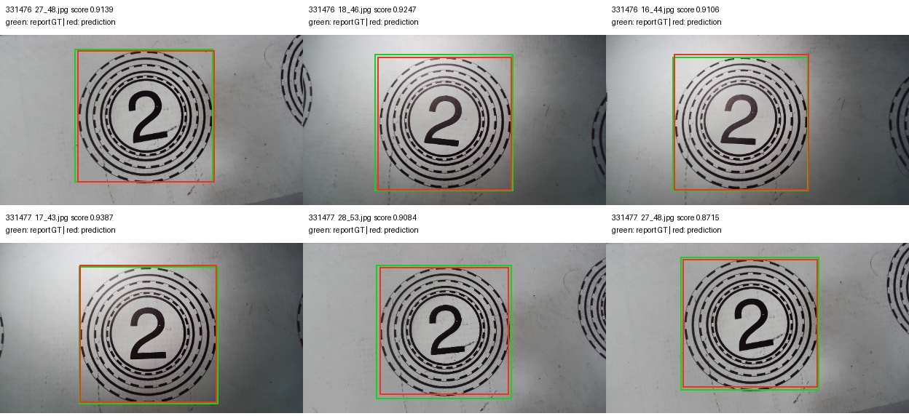

# 2号圈增强训练 v1（2026-11-19）

本轮两组训练已完成，MaixCAM模型包和报告已下载、校验并保存。优先实机测试候选为331476（batch 8），331477（batch 16）同时保留供对照。此建议基于少量报告抽样，尚不能证明实车准确率提高或完赛可靠性合格。本轮收尾后按用户要求暂停，没有提交下一轮训练，没有替换现有默认模型或烧录设备。

## 数据与参数

独立MaixHub训练项目：[147837](https://maixhub.com/model/training/project/147837/dashboard)；增强数据集：[157083](https://maixhub.com/model/training/dataset/157083/overview)。原数据集146275保留。

原42张训练图原样保留，14种不同JPEG字节内容各新增16个变体，新增224张，共266张训练图。12张验证图、XML和val.txt均逐字节保留。最后校验原数据110个文件SHA256全部一致。12张验证图只有6种不同JPEG字节内容；与训练集没有字节完全相同的交叉图，不能由此认定拍摄场景独立。

两组共有参数：MaixCAM、YOLOv5s、224×224、contain、200轮、学习率0.001、mean 0/std 255、标注框限制10、数据均衡关闭、允许负样本关闭。平台随机镜像/旋转/模糊全部关闭，离线增强已经包含几何和光照变化。实际服务器参数已逐项核对。

| 任务 | batch | 服务器部署列表更新时间（页面原文，时区未核实） | 保存位置 |
|---|---:|---|---|
| [331476](https://maixhub.com/model/training/project/147837/training/331476) | 8 | 2026-11-19 13:17:31 | ../../../models/ring2/trained_331476/ |
| [331477](https://maixhub.com/model/training/project/147837/training/331477) | 16 | 2026-11-19 13:16:10 | ../../../models/ring2/trained_331477/ |

## 报告抽样结果

以下每行仅来自该模型报告公开的3张抽样；抽样并非完全相同，不是同图全量公平评测，也不是量化模型实机推理。三组平台val_acc均为1.0，best_epoch均为200。

| 模型 | score≥0.70且IoU≥0.5 | 置信度范围 | 平均IoU | 平均/最大中心偏差（原图px） |
|---|---:|---|---:|---:|
| 上轮候选331402 | 3/3 | 0.7081～0.8831 | 0.8560 | 5.29 / 10.55 |
| 增强331476，batch 8 | 3/3 | 0.9106～0.9247 | 0.9530 | 2.63 / 3.16 |
| 增强331477，batch 16 | 3/3 | 0.8715～0.9387 | 0.9351 | 1.45 / 2.06 |

两组增强模型在各自3张抽样上没有超过0.70门槛的额外框。把报告框静态代入当前相机box_candidate，两组均3/3通过；该检查没有运行模型、霍夫精修或两帧稳定判断。报告原图416×234，相机脚本320×240，不能将此静态检查当作部署通过率。

两组新报告只有一张共同图片27_48.jpg，服务器图片ID相同。331476/331477在这张图上的置信度为0.9139/0.8715，IoU为0.9583/0.9364，中心偏差为3.16/0.71 px。这体现了取舍：331476在此图上置信度及框重叠更好，331477的中心更近。暂将置信度余量较大的331476作为优先实机测试候选；没有足够证据认定它在所有场景更好。

上排331476，下排331477；绿色为报告标注框，红色为预测框。已目视检查六张，均包住2号外圈。中心偏差比较的是标注框中心；comparison.json中的毫米值只是按外圈41.75 mm半径换算的估计，不是实测定位精度。

## 文件与验证

- 原始下载包：../../../models/ring2/model-331476.maixcam.zip、model-331477.maixcam.zip。
- 独立候选目录：../../../deploy/ring2_aug_331476/、../../../deploy/ring2_aug_331477/，各含model.mud、对应cvimodel和使用说明。
- 两个ZIP通过CRC检查，解压文件与ZIP内内容逐字节一致；MUD指向对应模型，类别2r、输入224×224已确认，见artifact_integrity.json。
- comparison.json保存报告逐图指标；paired_samples.json保存唯一共同抽样的比较；runtime_gate_replay.json保存当前框筛选函数的静态检查。
- dataset_integrity_after_training.json保存原数据及验证集未变的核对结果；selection.json记录候选选择和未完成验证。
- evaluate_downloads.py可重新生成上述分析与预览；使用现有/opt/miniconda3/envs/MISC/bin/python运行。没有修改固件或相机运行代码，因此未重复固件构建。

本地默认仍为../../../deploy/ring2/中的311465，上轮331402候选及其他存档保留。尚未在MaixCAM上验证量化模型、完整12张验证图、真实高位视角、1号/3号圈及无目标场景、帧率、两帧稳定或2.5秒粗定位窗口。

## 增强方法与局限

生成脚本：../generate_augmentation_v1.py。固定随机种子20261119，拒绝覆盖已有输出。manifest.json记录每张增强图片的来源、SHA256和具体参数；audit.json记录检查结果。qa_01～qa_07涵盖全部224张新增图，已目视检查目标完整及标注位置。

增强包含尺度0.62～1.03、平移、±6°以内旋转、亮度/对比度/gamma、水平光照梯度、轻微噪声、Gaussian/3像素水平运动模糊与JPEG质量变化。不镜像数字2，不裁掉目标。旋转框使用四角变换后的保守轴对齐包围框，可能比圆的紧框稍宽。缩放填充区域为人工合成，不能等同真实拍摄背景。

本地dataset保留images/annotations/train.txt/val.txt格式。MaixHub导入要求images和xml目录，并在页面明确选择训练或验证，因此分别使用maixhub_train_images_xml.zip和maixhub_val_images_xml.zip，未随机重划验证集。

增强仍来自14种原始训练图，没有增加独立真实场景、高位视角，或无目标、1号/3号圈等负样本。报告抽样改善是本轮可确认的有限证据，实车效果仍待验证。当前状态：本轮训练及归档已完成，进一步训练暂停。
